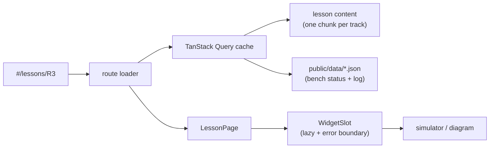

# esp-labs-web: the bench guide as a React app

The ESP32-S3 bench guide (once `hardware-diary/test-esp/guide/bench-guide.html`, one 11k-line HTML file) rebuilt as a modular React app: a labs map, a live pinout, the lessons of every track with their simulators, and the bench log. Same content, a PCB-flavoured look; lessons are data, simulators are lazily loaded widgets, and the bench log is JSON you can update without a rebuild.

It is its own repo and pnpm project, next to [esp-labs](https://github.com/agharsallah/esp-labs) (the firmware it explains), with its own lint and test setup. Clone both side by side: `~/…/esp-labs` and `~/…/esp-labs-web`. Architecture, data flow and how to extend it: **[docs/ARCHITECTURE.md](docs/ARCHITECTURE.md)**.



## Commands

Run them from this folder.

```sh
pnpm install          # once
pnpm dev              # http://localhost:5180
pnpm check            # typecheck + lint + tests
pnpm build            # static bundle in dist/ (relative paths: serve it from any folder)
pnpm preview          # serve dist/ locally (browsers will not run module scripts from file://)
```

## Deploy to Vercel

Configuration is in `vercel.json` (Vite preset, pnpm, cache and security headers). The app uses a hash
router, so no rewrite rules are needed.

The code reader bundles the firmware from the private `esp-labs` checkout at build time, and Vercel's build
servers cannot see it. So the deploy builds **locally** (`vercel build`, using `../esp-labs`) and uploads
the result with `--prebuilt`. Git-triggered builds are turned off in `vercel.json` for the same reason.

```sh
vercel login          # once
vercel link           # once: creates/links the project, writes .vercel/ (git-ignored)
pnpm deploy:preview   # preview deployment, prints its URL
pnpm deploy:prod      # production deployment
```

Web Analytics (`@vercel/analytics`) and Speed Insights (`@vercel/speed-insights`) are mounted by
`src/app/VercelInsights.tsx`, only in builds made for Vercel (`VERCEL` is set by `vercel build`), so dev and
a plain `pnpm build` load nothing. Switch both on once per project in the dashboard (**Analytics** and
**Speed Insights**, then **Enable**) and redeploy. Because the router is hash-based, `#/lessons/R3` is
reported as the page `/lessons/R3`.

## Configuration

Copy `.env.example` to `.env` to override:

| Variable              | Default          | Meaning                                                      |
| --------------------- | ---------------- | ------------------------------------------------------------ |
| `VITE_BENCH_DATA_URL` | `./data/`        | Where `bench-status.json` and `bench-log.json` are read      |
| `VITE_FIRMWARE_URL`   | `./firmware/`    | Where the bundled lab code is read                           |
| `VITE_LOG_LEVEL`      | `info`           | `debug`, `info`, `warn`, `error` or `silent`                 |
| `FIRMWARE_DIR`        | `../esp-labs` | Build time only: the firmware checkout the code reader shows |

## Where things live

| Path                     | What                                                                                                                 |
| ------------------------ | -------------------------------------------------------------------------------------------------------------------- |
| `src/content/`           | Tracks (table of contents) and lessons, one file per track; `code/` holds the phrasebook and hand-written code tours |
| `src/domain/code/`       | C++ tokenizer, analyser, line explainer and tour builder (pure, tested)                                              |
| `src/features/code/`     | The code reader: tour, explore, map, words                                                                           |
| `src/features/settings/` | Settings page and its store (level, hints, code display, motion)                                                     |
| `tools/firmware/`        | Reads `esp-labs` (or an old `test-esp`) and ships each env's code as JSON (Vite plugin)                              |
| `src/labs/<track>/`      | That track's simulators and explainers, registered in `widgets.ts`                                                   |
| `src/labs/shared/`       | `Simulation` and the lab-screen engine (screen + buttons + serial)                                                   |
| `src/features/home/`     | The labs map: continue card, every lab at a glance, one card per theme                                               |
| `src/features/`          | App screens: lesson sheet and dock, navigation, board pinout, bench log, progress                                    |
| `src/ui/`                | Design-system pieces: Panel, Button, Terminal, SequenceDiagram, RichText…                                            |
| `src/ui/parts/`          | The parts library: isometric illustrations of every component (`<PartIcon name="led" />`), gallery at `#/parts`      |
| `src/ui/stage3d/`        | The shared 3D stage (three.js): orbit camera, toolbar, leaders, ink outlines, toon materials                         |
| `src/lib/`               | Logger, storage, theme, palette, animation loop, http, clipboard                                                     |
| `src/styles/tokens.css`  | Every colour, font and radius; light and dark themes                                                                 |
| `public/data/`           | Bench status and log (validated with zod when fetched)                                                               |
| `docs-llm/`              | Offline React, React Router and TanStack Query docs used to build this                                               |

## Versions

All dependencies are pinned exactly (`savePrefix: ""`). React 19.3, React Router 8.4, TanStack Query 5.104, Vite 8.3, React Compiler 1.0, zod 4.6, three 0.186. TypeScript stays on 6.0 because typescript-eslint does not support TypeScript 7 yet.
