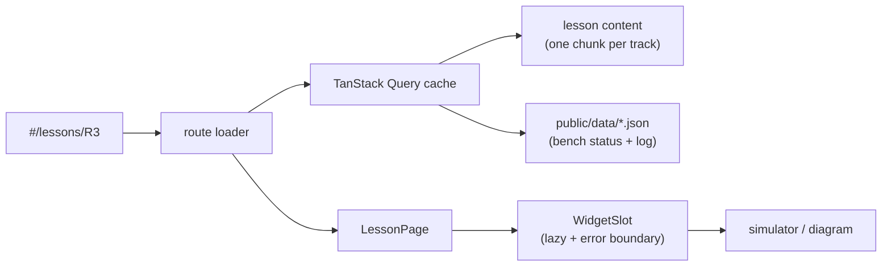

# test-esp-web: the bench guide as a React app

The ESP32-S3 bench guide (`test-esp/guide/bench-guide.html`, one 11k-line HTML file) rebuilt as a modular React app: a live pinout, the lessons of every track with their simulators, and the bench log. Same content and look; lessons are data, simulators are lazily loaded widgets, and the bench log is JSON you can update without a rebuild.

It is a standalone pnpm project, like `test-esp/dashboard`: not part of the monorepo workspace, with its own lint and test setup. Architecture, data flow and how to extend it: **[docs/ARCHITECTURE.md](docs/ARCHITECTURE.md)**.



## Commands

Run them from this folder.

```sh
pnpm install          # once
pnpm dev              # http://localhost:5180
pnpm check            # typecheck + lint + tests
pnpm build            # static bundle in dist/ (relative paths: serve it from any folder)
pnpm preview          # serve dist/ locally (browsers will not run module scripts from file://)
```

## Configuration

Copy `.env.example` to `.env` to override:

| Variable              | Default   | Meaning                                                 |
| --------------------- | --------- | ------------------------------------------------------- |
| `VITE_BENCH_DATA_URL` | `./data/` | Where `bench-status.json` and `bench-log.json` are read |
| `VITE_LOG_LEVEL`      | `info`    | `debug`, `info`, `warn`, `error` or `silent`            |

## Where things live

| Path                    | What                                                                      |
| ----------------------- | ------------------------------------------------------------------------- |
| `src/content/`          | Tracks (table of contents) and lessons, one file per track                |
| `src/labs/<track>/`     | That track's simulators and explainers, registered in `widgets.ts`        |
| `src/labs/shared/`      | `Simulation` and the lab-screen engine (screen + buttons + serial)        |
| `src/features/`         | App screens: lesson page, navigation, board pinout, bench log, progress   |
| `src/ui/`               | Design-system pieces: Panel, Button, Terminal, SequenceDiagram, RichText… |
| `src/lib/`              | Logger, storage, theme, palette, animation loop, http, clipboard          |
| `src/styles/tokens.css` | Every colour, font and radius; light and dark themes                      |
| `public/data/`          | Bench status and log (validated with zod when fetched)                    |
| `docs-llm/`             | Offline React, React Router and TanStack Query docs used to build this    |

## Versions

All dependencies are pinned exactly (`savePrefix: ""`). React 19.3, React Router 8.4, TanStack Query 5.104, Vite 8.3, React Compiler 1.0, zod 4.6, three 0.186. TypeScript stays on 6.0 because typescript-eslint does not support TypeScript 7 yet.
