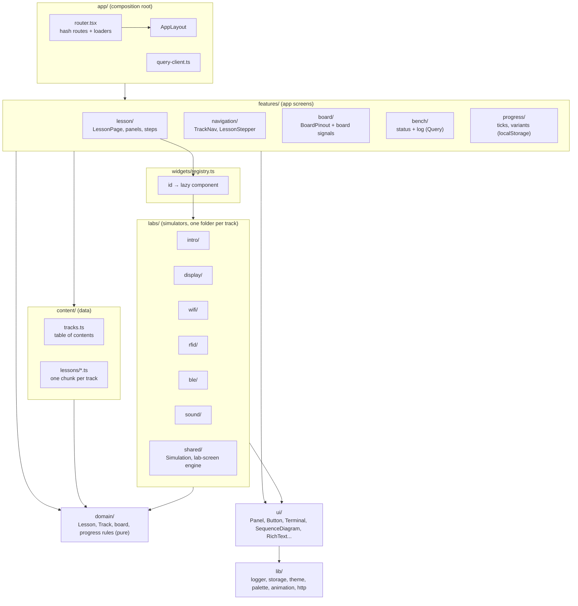
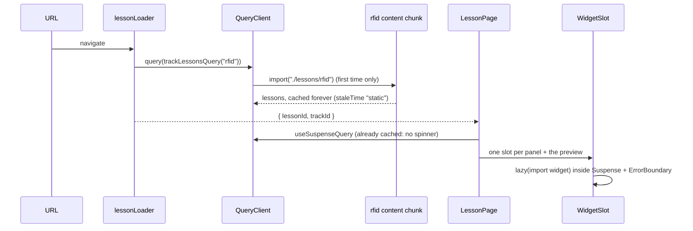
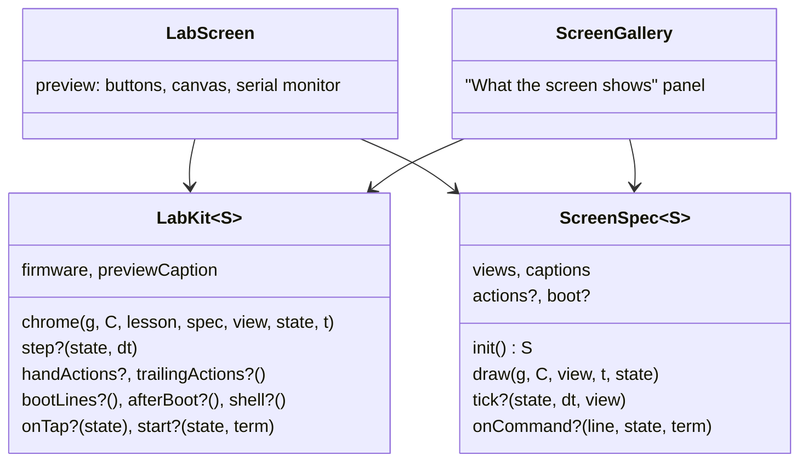

# Bench guide (React): architecture

The ESP32-S3 bench guide, rebuilt from the single 11k-line `test-esp/guide/bench-guide.html` into a React 19 app. Same content, same look, now modular: lessons are data, simulators are lazily loaded widgets, bench state is fetched JSON.

## Stack

| Concern      | Choice                                                                                  | Why                                                                                          |
| ------------ | --------------------------------------------------------------------------------------- | -------------------------------------------------------------------------------------------- |
| UI           | React 19.3 + React Compiler 1.0                                                         | Automatic memoization; no hand-written `useMemo`/`useCallback`                               |
| Build        | Vite 8 (Rolldown), `base: "./"`                                                         | One static bundle that runs on any static host, in any subfolder, or as a claude.ai artifact |
| Routing      | React Router 8, data mode, `createHashRouter`                                           | Loaders prefetch content before render; hash URLs need no server rewrites                    |
| Server state | TanStack Query 5                                                                        | Bench log/status JSON and lesson content chunks: cache, dedupe, retries, refetch on focus    |
| Validation   | zod 4                                                                                   | Env config and every fetched JSON document are parsed at the boundary                        |
| Styles       | CSS Modules + design tokens (`src/styles/tokens.css`)                                   | Scoped, zero runtime; themes are token sets                                                  |
| Quality      | TypeScript 6 strict, ESLint (react-hooks incl. compiler rules, jsx-a11y, query), Vitest | TS 6 because typescript-eslint does not support TS 7 yet                                     |

## Layers



Dependencies point down only: `domain` and `lib` know nothing about React screens; `labs/<track>` never imports another track.

## A page load, end to end



## Content model

- `src/content/tracks.ts` is the table of contents: tracks, their colour token and their lesson ids in order.
- `src/content/lessons/<track>.ts` holds the lessons (`LessonEntry` in `src/domain/lesson.ts`). Text fields may carry `<b>`, `<i>`, `<code>` and `<span class="snd-parts|need|opt">`; `RichText` turns them into React elements from an allow-list (no `dangerouslySetInnerHTML`).
- A lesson names its explainers in `panels: [{ title, widget, intro?, view?, flows? }]` and its simulator in `preview: { widget, view? }`. Widget ids are type-checked against the registry.
- Variants (03b, W2) override any body field; the URL `?variant=` wins, then your last choice.

## Widgets

Every simulator, diagram and explainer implements one contract, `WidgetProps` (`src/widgets/types.ts`):

```ts
interface WidgetProps {
  lesson: ResolvedLesson;
  panel?: PanelSpec;
}
```

`panel` is set when the widget is a lesson panel (read `panel.view`, `panel.flows`), undefined when it is the lesson's preview (read `lesson.preview`, `lesson.previewMode`). Each track registers its widgets in `src/labs/<track>/widgets.ts` with `lazyWidget(() => import("./X"), "X")`, so a widget's code (and libraries such as three.js) downloads only when a lesson shows it. `WidgetSlot` wraps each one in `Suspense` and an `ErrorBoundary`: a broken simulator shows an error in its own panel, logs it, and the rest of the lesson keeps working.

## Simulators: React around imperative drawing

Simulators animate at 60 fps, so they follow three rules:

1. **Logic is plain TypeScript.** Firmware behaviour (command parsing, state machines, protocol maths) lives in `.ts` modules with pure functions, unit-tested without a DOM. Example: `labs/intro/led-firmware.ts`.
2. **Per-frame state is not React state.** It lives in a ref or a `Simulation` (`labs/shared/simulation.ts`) and is read by `useFrameLoop`, which pauses while the canvas is off screen. React re-renders only on discrete changes: `sim.update(change)` mutates `sim.state` and notifies, and render code reads `snapshot.state`, a fresh shallow copy per notify (so React Compiler memoization never serves a stale derivation). Never mutate the snapshot.
3. **DOM written per frame is DOM React leaves empty.** A frame loop may set attributes or `textContent` on nodes React renders without children (see `SequenceDiagram`'s live payload and `LedPreview`'s duty text), never on nodes React fills.

The lab-screen engine (`labs/shared/lab-screen/`) is the shared shape of the RFID, BLE and sound previews:



A track writes one `LabKit` (its status bar, its shared hardware model, its common buttons and commands, `subscribe` for outside state its buttons show) and one `ScreenSpec` per lab; `bindLab(kit, spec)` pairs them (a record of labs with different state types, no casts) and `LabScreen` / `ScreenGallery` do the rest. RFID R1–R6, the 03b showcase and the Wi-Fi previews have their own button gestures and status bars, so they compose `ScreenFrame`, `Terminal`, `useFrameLoop` and `useSimulation` directly instead.

Other shared pieces: `PushButton` / `HoldButton` / `BoardButton` (the board's push button: click, double-click, hold, by pointer or keyboard), `ScrollBox` (wide drawings and tables scroll inside themselves on phones), `Terminal` + `TerminalLog` (a serial monitor any code can print to), `SequenceDiagram` (steppable message flows), `useBoardRgb()` (light the RGB LED on the board drawing), `scopePalette()` / `definePalette()` (canvas colours from CSS tokens, re-read after a theme change), `useInterval`, `useReducedMotion`.

## State

| State                               | Where                                                                               | Why                                                      |
| ----------------------------------- | ----------------------------------------------------------------------------------- | -------------------------------------------------------- |
| Lesson content                      | Query cache, `staleTime: "static"`                                                  | Bundled, never changes while the page is open            |
| Bench status + log                  | Query cache, fresh for 60 s, refetched on focus                                     | Changes when Claude records a command; no rebuild needed |
| Ticks, last lesson, variants, theme | `createPersistentStore` (localStorage + `useSyncExternalStore`, synced across tabs) | Yours, in this browser only                              |
| Variant, log filter                 | URL search params                                                                   | Shareable                                                |
| Simulator internals                 | refs / `Simulation`                                                                 | 60 fps, not rendering state                              |

## Configuration, logging, errors

- `src/config/env.ts` parses `import.meta.env` with zod at start-up. `VITE_BENCH_DATA_URL` points at the bench JSON (default `./data/`), `VITE_LOG_LEVEL` filters logs. See `.env.example`.
- `src/lib/logger.ts` emits structured events (`level, scope, message, data, at`) to pluggable sinks (console by default). Query failures, route errors, render errors (`createRoot` hooks), widget crashes, uncaught errors and unhandled rejections are all logged once, centrally.
- Errors are contained at three levels: route `ErrorBoundary` (404, failed loaders), per-widget `ErrorBoundary`, and a simulator's own draw guard (a failing view draws its error on the simulated screen).

## Updating the bench data

Append an entry to `public/data/bench-log.json` (shape: `LogEntrySchema` in `src/features/bench/schema.ts`) and update `public/data/bench-status.json`. A running guide picks it up on the next focus; no rebuild.

## Adding things

- **A lesson**: add it to `src/content/lessons/<track>.ts` and its id to the track's `lessonIds` in `tracks.ts`.
- **A track**: an entry in `TRACKS`, a lessons file, a loader in `content/queries.ts`, a `labs/<track>/widgets.ts` spread into `widgets/registry.ts`, and a colour token.
- **A widget**: a component taking `WidgetProps` in `labs/<track>/`, one line in that track's `widgets.ts`, then reference its id from a lesson.
- **A theme**: a token block in `tokens.css` and an entry in `THEMES` (`src/lib/theme.ts`).
